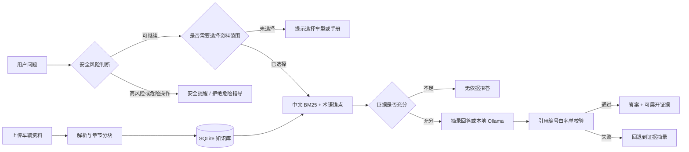

# 车维智答（AutoCare）｜汽车售后知识 RAG

一个面向汽车售后咨询场景的本地知识助手：把车辆手册转换为可检索知识，在用户明确选择的车型/资料范围内回答问题，并展示可核对的原文证据。

> 项目定位：AI 产品经理作品集 / 可运行 MVP。它验证的是“范围隔离、证据可追溯、安全优先和无依据拒答”，不替代厂商手册、专业诊断、道路救援或紧急服务。

## 为什么做这个项目

通用大模型回答汽车维修与保养问题时，容易出现三个产品风险：不同车型参数混用、没有资料仍然作答、危险问题只给普通检索结果。本项目围绕这三个风险设计最小闭环：

1. 导入 PDF、TXT 或 Markdown 车辆资料；
2. 为资料补充车型、年款、动力类型和版本元数据；
3. 提问前先做安全风险判断，再限定检索范围；
4. 只根据选中资料回答，并展示页码、章节和证据块；
5. 资料不足、模型离线或引用不合法时，拒答或回退到可验证摘录。

## 核心能力

- **车型范围隔离**：多份手册并存时要求选择查询范围，避免参数串库；
- **中文汽车检索**：BM25、术语锚点、同义词归一及 DTC/零件号精确匹配；
- **证据可追溯**：保留来源、PDF 页码、章节、稳定文档 ID 和知识块 ID；
- **安全优先**：制动失效、冒烟、起火等风险在检索前识别，空库仍给安全提示；
- **无依据拒答**：通用词命中不会被当作有效证据；
- **引用守卫**：Ollama 只能引用已提供的 `[E1]` 等证据编号，否则自动回退；
- **本地持久化**：SQLite 保存文档和知识块，重启后自动恢复；
- **双入口演示**：同时提供 Streamlit 页面和命令行工具。

## 产品与技术流程



延伸文档：

- [产品案例：从问题定义到指标设计](docs/PRODUCT_CASE.md)
- [系统架构与安全降级设计](docs/ARCHITECTURE.md)
- [5 分钟面试演示脚本](docs/DEMO.md)
- [验收清单](验收清单.md)

## 快速开始

推荐 Python 3.11 或 3.12。

### Windows PowerShell

```powershell
git clone https://github.com/whisper-yyyy/autocare.git
cd autocare
python -m venv .venv
.\.venv\Scripts\Activate.ps1
python -m pip install -r requirements.txt
.\run.ps1
```

### macOS / Linux

```bash
git clone https://github.com/whisper-yyyy/autocare.git
cd autocare
python3 -m venv .venv
source .venv/bin/activate
python -m pip install -r requirements.txt
python -m streamlit run app.py --server.address 127.0.0.1
```

浏览器打开 `http://localhost:8501`，点击“加载内置演示资料”，然后提问：

```text
刹车油多久换一次？
```

预期答案包含“两年、四万公里、以先到者为准”，并能展开“第二章 制动系统与制动液”的原文证据。

## 命令行演示

```powershell
.\.venv\Scripts\python.exe cli.py --question "冷车启动困难可能和电瓶有关吗？"
```

导入多份资料时，可以限定本次查询的文件：

```powershell
.\.venv\Scripts\python.exe cli.py `
  --file ".\A车型手册.txt" `
  --file ".\B车型手册.txt" `
  --source "A车型手册.txt" `
  --question "应该使用什么机油？"
```

## 可选：本地 Ollama

项目默认使用确定性摘录模式，不依赖云端 API。若本机已安装 Ollama，可执行：

```powershell
ollama pull qwen2.5:7b-instruct-q4_K_M
```

页面开启“使用本地 Ollama 生成答案”后才会调用模型。服务地址只允许 `localhost`、`127.0.0.1` 和 `::1`，模型离线、超时或引用校验失败时自动回退。

## 自动化验证

```powershell
python -m pip install -r requirements-dev.txt
python -m pytest -q
```

当前本地结果：`26 passed，10 subtests passed`。GitHub Actions 会在每次 push 和 pull request 时运行同一套测试。覆盖范围包括：

- 章节分块、页码及稳定 ID；
- 中文同义词、DTC 精确检索和关键句摘录；
- 无依据拒答与危险表达变体；
- 高风险问题在空知识库下的安全提示；
- 多车型范围隔离；
- SQLite 恢复、清空和重复内容去重；
- Ollama 离线回退和引用编号校验。

## 目录结构

```text
.
├── .github/workflows/test.yml      # GitHub Actions 自动测试
├── app.py                          # Streamlit 页面
├── cli.py                          # 命令行演示
├── run.ps1                         # Windows 一键启动
├── data/demo_vehicle_manual.txt    # 虚构演示资料
├── docs/
│   ├── PRODUCT_CASE.md             # AI 产品案例
│   ├── ARCHITECTURE.md             # 架构和降级策略
│   └── DEMO.md                     # 面试演示脚本
├── src/automotive_rag/
│   ├── chunking.py                 # 章节识别、分块与稳定 ID
│   ├── ingestion.py                # PDF/TXT/MD 导入
│   ├── retrieval.py                # 中文 BM25、锚点与同义词
│   ├── safety.py                   # 安全意图前置判断
│   ├── generation.py               # Ollama、引用校验与摘录
│   ├── storage.py                  # SQLite 持久化
│   ├── pipeline.py                 # 流程编排与范围过滤
│   └── models.py                   # 数据结构
├── tests/                          # 单元与回归测试
├── requirements.txt               # 运行依赖
└── requirements-dev.txt           # 测试依赖
```

## 产品边界

- 演示资料完全虚构，不对应真实品牌或车型；
- 扫描版 PDF 暂无 OCR，混合型 PDF 的扫描页需人工核对；
- 当前检索适合本地 MVP，大规模知识库应升级为混合向量召回与重排序；
- 规则安全层不能覆盖全部真实风险，不代替专业人员判断；
- 项目未连接真实 4S 店、CRM、车主账号或车辆数据。

## 开源参考与独立改造说明

产品方向调研参考了 [algorhythm-7/RAG-App](https://github.com/algorhythm-7/RAG-App) 的汽车手册问答场景。本仓库没有直接复制其源文件，而是围绕相同业务主题重新实现轻量架构。

| 维度 | 参考项目 | 本项目 |
| --- | --- | --- |
| 检索 | 向量检索、BM25、重排、CRAG | 中文 BM25、术语锚点、确定性阈值 |
| 文档 | 多模态、OCR、图片与视频 | PDF、TXT、Markdown |
| 存储 | 会话态及向量数据库 | SQLite 文档与知识块持久化 |
| 车型隔离 | 通用文档问答 | 强制选择文档/车型范围 |
| 引用控制 | 来源归因 | `[E1]` 白名单校验与失败回退 |
| 模型依赖 | 云端或本地模型 | 默认无模型，Ollama 可选 |

这一取舍不是追求功能最多，而是优先保证作品集可运行、可解释、可测试，并突出汽车知识问答的安全边界。

## License

本项目采用 [MIT License](LICENSE)。第三方项目与依赖仍遵循各自许可证。
