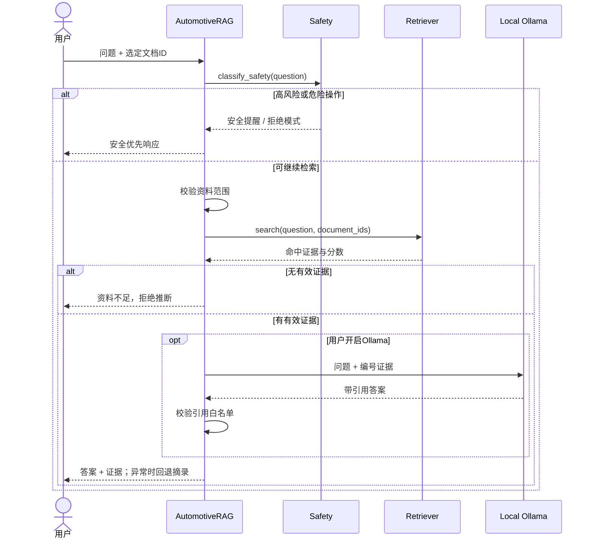

# 系统架构与安全降级设计

## 1. 设计目标

系统围绕四个约束设计：本地可运行、回答有证据、车型不串库、高风险优先处理。大模型不是强依赖，任何外部能力不可用时都应有明确降级路径。

## 2. 模块职责

| 模块 | 职责 |
| --- | --- |
| `ingestion.py` | 读取PDF、TXT和Markdown，生成带来源元数据的知识块 |
| `chunking.py` | 识别中文章节、控制重叠、生成稳定文档与知识块ID |
| `storage.py` | 用SQLite持久化文档、元数据和知识块 |
| `retrieval.py` | 中文分词、BM25评分、同义词归一和术语锚点加权 |
| `safety.py` | 在检索前识别高风险症状及危险操作意图 |
| `generation.py` | 构建证据上下文、调用本地Ollama、校验引用并生成摘录 |
| `pipeline.py` | 编排资料范围、安全、检索、拒答、生成和降级 |
| `app.py` | Streamlit交互、资料选择、证据展示和知识库管理 |
| `cli.py` | 无页面环境下的最小演示入口 |

## 3. 查询时序

## 4. 数据设计

`DocumentInfo`保存资料级元数据，包括来源、车型、年款、动力类型、市场版本和手册版本；`Chunk`保存正文、章节、页码、稳定ID和相同元数据。检索时通过`document_ids`硬过滤，避免只依赖提示词约束范围。

稳定ID根据内容和来源信息生成：同一份资料重复导入不会无限复制，应用重启后引用仍可核对。

## 5. 检索策略

当前MVP不依赖向量模型：

1. 对中文、英文、数字、DTC和零件号进行规则化切分；
2. 将“刹车油/制动液”“电瓶/蓄电池”等表达归一；
3. 用BM25评估词项稀有度和文档相关性；
4. 用汽车专业术语锚点提高精确概念的权重；
5. 结合锚点覆盖率、分数阈值和通用词过滤判断证据是否充分。

优点是无需下载Embedding模型、结果可解释；限制是语义泛化能力有限。数据规模和评测集扩大后，下一步才引入中文向量召回和Cross-Encoder重排。

## 6. 降级矩阵

| 异常 | 系统行为 |
| --- | --- |
| 知识库为空 | 普通问题提示先导入资料；高风险问题仍给安全提示 |
| 多份资料未选范围 | 不检索，要求先选择资料 |
| 检索证据不足 | 明确拒答，不补全常识 |
| Ollama未启动或超时 | 回退到确定性证据摘录 |
| 模型未提供引用 | 回退到确定性证据摘录 |
| 模型伪造引用编号 | 拒绝模型结果并回退 |
| 非本机Ollama地址 | 在发起请求前拒绝 |
| 重复导入同一资料 | 使用稳定ID和数据库约束去重 |

## 7. 安全边界

安全规则用于MVP风险控制，不是完整诊断系统。真实产品需要汽车工程、法务、安全和售后专家共同维护规则，并为不同国家、市场版本和车型建立经过审核的策略库。
